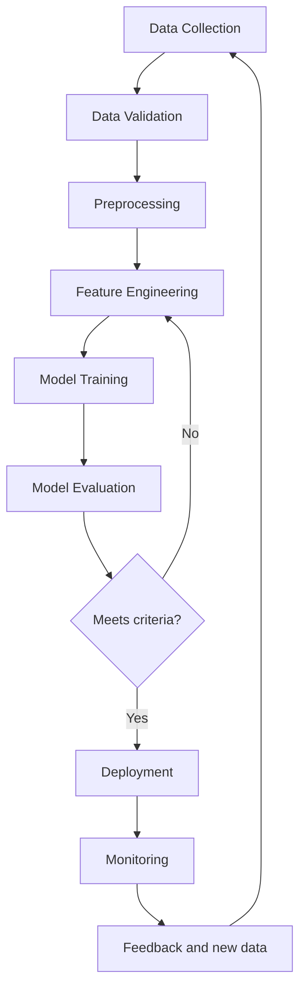

# Experiment 1 — Introduction to MLOps

## Aim
Study MLOps, compare software development, DevOps and MLOps, review the lifecycle, components, production challenges and tools, and prepare a workflow diagram.

## Comparison
| Aspect | Software development | DevOps | MLOps |
|---|---|---|---|
| Focus | Build software | Reliable software delivery and operations | Reliable ML lifecycle |
| Artifacts | Code and application | Code, builds, configuration | Code, data, features, models and configuration |
| Testing | Unit/integration tests | Automated tests and deployment checks | Software tests, data validation and model evaluation |
| Monitoring | Application behavior | Application and infrastructure | Application, data drift and model quality |

## Lifecycle
Data collection → validation → preprocessing → feature engineering → training → evaluation → deployment → monitoring → feedback/retraining.

## Tools survey
Git/GitHub (source control), DVC (data versioning), Pandas (data processing), MLflow (experiment tracking), Docker (packaging), Airflow (orchestration), FastAPI (serving), Evidently/Prometheus/Grafana (monitoring).

## Production challenges
Missing/biased data, leakage, training-serving skew, model/data drift, reproducibility, dependency changes, latency, scale, cost, security and privacy.

## Workflow diagram

## Result
MLOps concepts, lifecycle, tools and production challenges were reviewed and a workflow was documented.

## Execution evidence and report update
After running `python experiment-1-mlops-introduction\workflow_demo.py` from the repository root:
- Confirm the workflow stages appear in the terminal.
- Confirm `workflow_output.txt` is created in this folder.
- Add a screenshot of the successful terminal output to an `evidence/` folder, if screenshots are required by your instructor.
- Record the date of execution and the actual result below.

**Execution date:** _Fill after running_

**Actual result:** _Write what you observed in the terminal; do not claim success before execution._

**Evidence:** _Add screenshot filename or link, if required._
